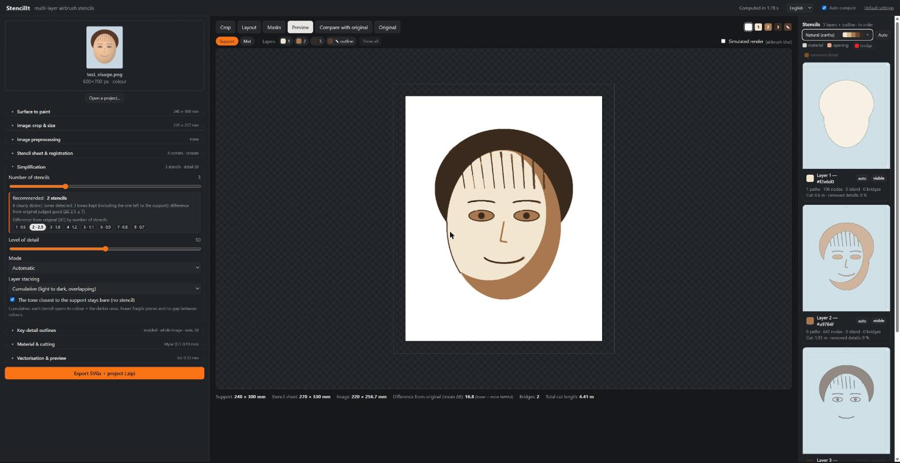
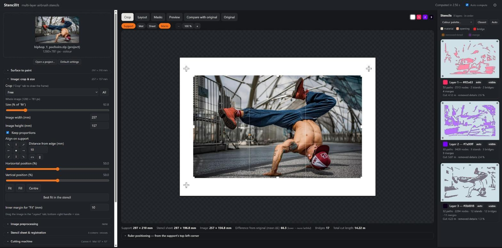
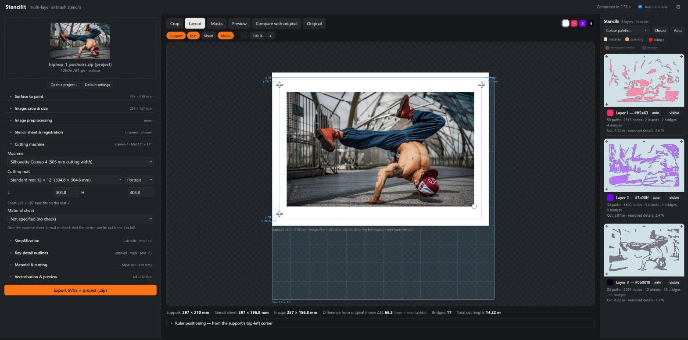
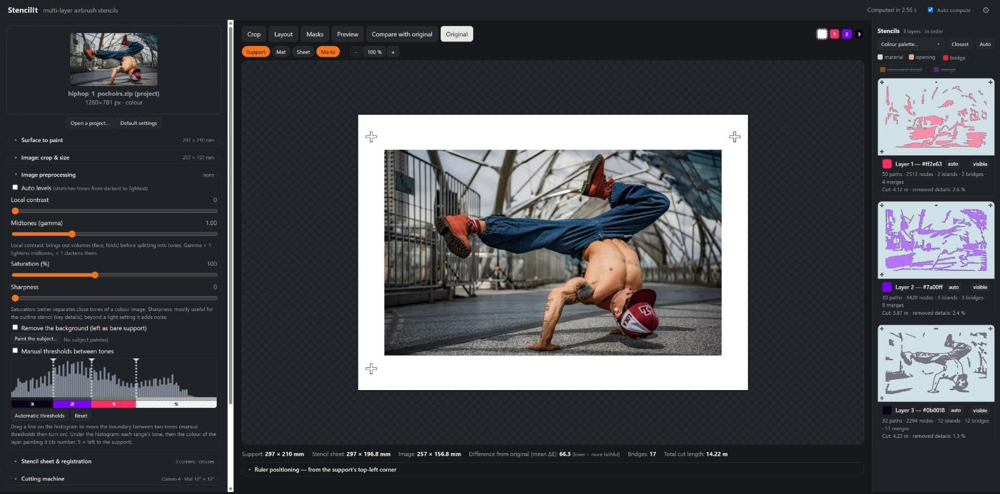
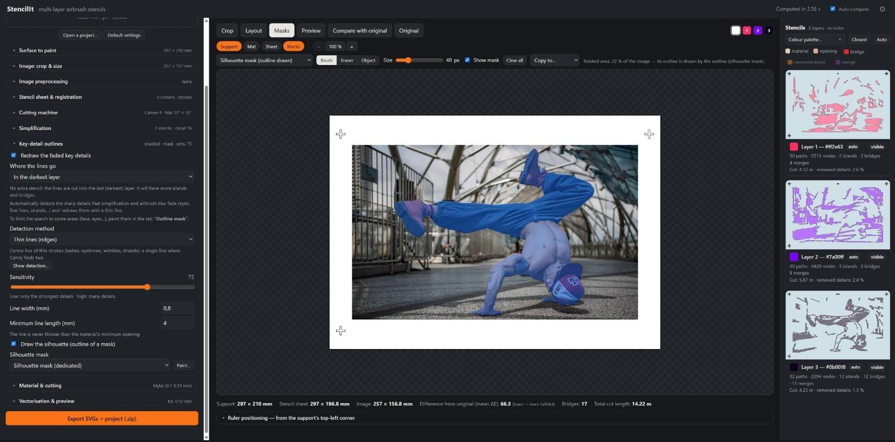
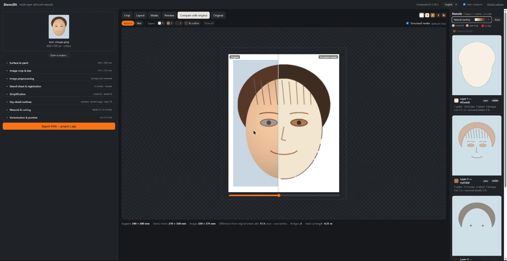
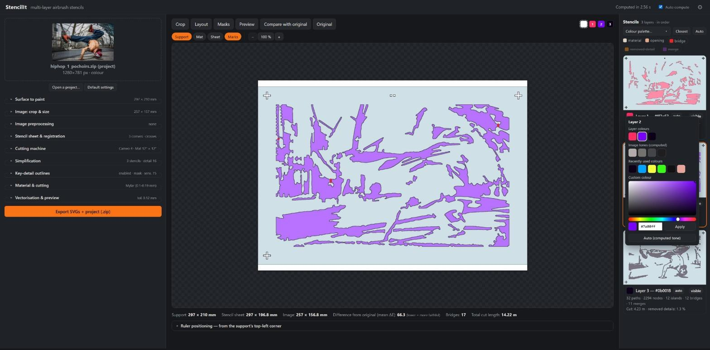

# StencilIt

**Turn any picture into a set of multi-layer airbrush stencils, ready to cut on a Silhouette Cameo.**

StencilIt is a small web application that runs on your own computer. You give it a photo or a
drawing; it reduces the image to a few paint tones, builds one cuttable stencil per tone, adds
the bridges that keep the stencils in one piece and the registration marks that let you line
them up, and exports everything as **SVG files in millimetres**.



---

## Contents

1. [What is a multi-layer stencil?](#1-what-is-a-multi-layer-stencil)
2. [Installation](#2-installation)
3. [Quick start (5 minutes)](#3-quick-start-5-minutes)
4. [The interface at a glance](#4-the-interface-at-a-glance)
5. [Step-by-step guide](#5-step-by-step-guide)
6. [Cutting and painting](#6-cutting-and-painting)
7. [Projects and saved settings](#7-projects-and-saved-settings)
8. [Tips and troubleshooting](#8-tips-and-troubleshooting)
9. [How it works (for the curious)](#9-how-it-works-for-the-curious)

---

## 1. What is a multi-layer stencil?

With an airbrush you build an image **from the lightest tone to the darkest**, spraying through one
stencil after another:

```
 Support (bare)    Layer 1 (light)    Layer 2 (mid)     Layer 3 (dark)    Outline (optional)
 ┌──────────┐      ┌──────────┐       ┌──────────┐      ┌──────────┐      ┌──────────┐
 │          │  →   │  ░░░░░░  │   →   │  ░▒▒▒▒░  │  →   │  ░▒██▒░  │  →   │  ░▒██▒░  │
 │          │      │ ░░░░░░░░ │       │ ░▒▒▒▒▒▒░ │      │ ░▒████▒░ │      │ ░▒█──█▒░ │
 └──────────┘      └──────────┘       └──────────┘      └──────────┘      └──────────┘
```

StencilIt does all the tedious work for you:

| Problem | What StencilIt does |
|---|---|
| A photo has millions of colours | Reduces it to **2 – 8 paint tones**, sorted from light to dark (spraying order). |
| A hole inside a hole falls out of the stencil (the inside of an "O") | Detects these **islands** and adds thin **bridges** to hold them, preferably where a darker layer will paint over them. |
| Shapes too thin to cut or too fragile | Enforces the **material limits** (minimum opening, minimum material strip, minimum piece area). |
| Layers must line up perfectly | Adds **registration marks** (corner brackets, crosses or pin holes) and **notches** showing the layer number. |
| Fine details get lost in the blur of the airbrush | Optional **outline stencil** that redraws the key details with a thin line, sprayed last. |

**Vocabulary used in this guide**

- **Support** – the surface you paint on (paper, canvas, wall…).
- **Stencil sheet** – the piece of stencil material (Mylar, vinyl, card) for one layer.
- **Layer / stencil** – one sheet = one paint tone.
- **Island** – a piece of stencil material completely surrounded by an opening.
- **Bridge** – a thin strip that connects an island to the rest of the sheet.
- **Cutting mat** – the sticky mat that carries the sheet through the Cameo.

---

## 2. Installation

Requirements: **Windows** with **Python 3.10 or newer** (tick "Add Python to PATH" when installing
it). Any recent browser works.

**The easy way:** double-click **`lancer.bat`**.
The first launch creates a virtual environment and installs the dependencies (one or two minutes),
then your browser opens on **http://127.0.0.1:5000**.

**Manually** (any OS):

```
python -m venv .venv
.venv\Scripts\python -m pip install -r requirements.txt      # Linux/macOS: .venv/bin/python
.venv\Scripts\python app.py
```

then open http://127.0.0.1:5000. Keep the console window open while you work; close it to stop
the application. Nothing leaves your computer.

The **Object** selection tool (Masks tab) downloads its model once, on first use: MobileSAM in
ONNX format, about 45 MB, from Hugging Face, checked by its SHA-256 and kept in `models/`. The
selection itself runs on your computer; your images are never sent anywhere.

The interface is in **English** by default; the **⚙ Preferences** button at the top right holds the
language selector (**French** is available; the exported files follow the selected language).

---

## 3. Quick start (5 minutes)

1. **Drop an image** on the image box at the top left (or click it). `samples/test_visage.png`
   is a good first test.
2. In **Surface to paint**, pick the size of your support (e.g. *A4*, *24 × 30 cm* or *6F*) and
   its colour.
3. In **Simplification**, choose the **Number of stencils** (3 is a good start).
4. In **Cutting machine**, pick your machine and **Cutting mat**, then in **Material & cutting** your
   material (e.g. *Mylar*).
5. Look at the **Preview** tab and the stencil cards on the right. Happy? Click
   **Export SVGs + project (.zip)**.

Open the SVG files of the zip in Silhouette Studio, cut, and spray layer 1, 2, 3… in order.

---

## 4. The interface at a glance

```
┌──────────────────────────────────────────────────────────────────────────────────────┐
│ StencilIt            status · Auto compute · Recompute · ⚙                           │  ← header
├────────────────────┬────────────────────────────────────────────┬────────────────────┤
│ Image box          │ Crop | Layout | Masks | Preview |          │ Stencils           │
│ Open a project…    │ Compare with original | Original    1 2 3  │ palette menu       │
│ Default settings   │ Support  Mat  Sheet  Marks                 │ legend             │
│ Settings sections  │                                            │ one card per layer │
│  (accordion)       │            main view                       │  (click = enlarge) │
│ Export button      │ summary: sizes, ΔE, bridges, cut length    │                    │
└────────────────────┴────────────────────────────────────────────┴────────────────────┘
```

- **Left column – settings**, grouped in sections. Each closed section shows a summary of its
  values. Hover any setting to get a tooltip explaining it.
- **Centre – the views** (tabs) and, above the view, the layer buttons **1 2 3 …** to hide/show
  layers, plus the **Support**, **Mat**, **Sheet** and **Marks** buttons to show the support, the
  cutting mat, the material sheet and the registration marks in every view.
  In every view the **mouse wheel zooms** around the cursor. To move the zoomed image, drag it in the
  computed views (Preview, Compare, Original, a single layer); in Crop, Layout and Masks, where the
  left button edits, drag with the **middle button** or hold **Space** while dragging. A
  **double-click** (except in Masks) or the *%* button fits it back; the zoom is kept when you
  switch views.
- **Right column – the stencils**: one card per layer with its colour, statistics (paths, nodes,
  islands, bridges, cut length) and warnings. Click a card to see that layer alone in the main view.
- Both side columns can be **resized** by dragging their inner edge (double-click = default width).

**Auto compute** (header): when ticked, every change recomputes the stencils. Untick it for big
images: the header button turns into a pulsing orange **Recompute ●** as soon as a setting has
changed; click it or press **Ctrl + Enter**. While a computation runs, the header turns orange and
striped.

---

## 5. Step-by-step guide

### 5.1 Load an image

Drop a JPEG/PNG/WebP/AVIF file on the image box, or click it to browse. Colour and black & white images
are both supported. **Open a project…** below the box reloads a previous export (see
[§7](#7-projects-and-saved-settings)).

> Tip: an image with clear shapes and good contrast gives better stencils than a busy, low-contrast
> photo. A portrait with a plain background is ideal.

### 5.2 Surface to paint

Choose what you will paint on:

- **Format**: ISO paper (A6 → A2, US Letter), common canvases and frames (20 × 20 → 70 × 100 cm),
  French stretcher sizes **Figure / Paysage / Marine** (0F → 120F, e.g. 6F = 41 × 33 cm), or a custom
  size. Then the **orientation**.
- **Support colour**: the preview and the simulated render are computed on this colour. The image
  tone closest to it can be left **bare** (no stencil needed).
- **Inner margin**: blank space kept between the image and the edge of the support.

### 5.3 Image: crop & size

**Crop** tab – drag the frame handles to keep only the part of the image you want. The aspect
ratio can be free, the support's, or fixed (1:1, 4:3, 3:4, 16:9, 9:16).



**Layout** tab – place the image on the support:

- drag the image to move it, the bottom-right handle to resize it
  (hold **Shift** for free proportions);
- buttons **Fit / Fill / Centre**, or type the size in mm or in % of "fitted to the support";
- **alignment** on 9 positions (corners, edge middles, centre) at a chosen distance from the edge;
- **Best fit in the stencil** makes the image as large as possible for the chosen stencil sheet
  and cutting mat, and picks the best orientation automatically.

Anything outside the support is trimmed (full bleed). With the **Mat** button on, the cutting mat is
drawn with its inch grid, so you immediately see whether the sheet fits.



### 5.4 Image preprocessing (optional)

These settings improve the image **before** it is split into tones. The **Original** tab shows the
preprocessed image instantly (even in on-demand mode), with its luminance histogram.

| Setting | Use it when… |
|---|---|
| **Auto levels** | the image is dull or does not use the full range from black to white. |
| **Local contrast** (CLAHE) | volumes (face, folds) look flat; brings them out area by area. |
| **Midtones (gamma)** | the middle tones are too dark (> 1 lightens) or too light (< 1 darkens). |
| **Saturation** | two different colours end up in the same tone (colour images). |
| **Sharpness** | you use the outline stencil and want crisper edges (keep it light). |
| **Manual thresholds between tones** | you want to decide yourself where one tone ends and the next begins. |
| **Remove the background** | the background should stay bare support (see §5.6). |

**Manual thresholds**: the histogram shows one line per boundary between two tones (dotted lines =
automatic thresholds). Drag a line to switch to manual thresholds: each tone becomes a luminance
range (controlled posterisation). **Automatic thresholds** goes back to automatic mode.



### 5.5 Simplification

- **Number of stencils**: number of painted tones (the bare support and the outline stencil are
  not counted). StencilIt shows a recommendation for your image. More stencils = more faithful but
  more cutting and more painting.
- **Level of detail**: low = simple smooth shapes; high = more small details (and more bridges).
- **Layer stacking**:
  - **Cumulative** (recommended) – each stencil opens its own tone *and all darker ones*. Layers
    overlap, so small registration errors do not leave gaps.
  - **Exclusive** – each stencil opens only its own tone (useful for flat, poster-like colours).
- **Protect thin strokes from simplification**: thin dark or light strokes (eyes, eyebrows,
  nostrils, strands) keep their own tone instead of being absorbed by the area around them.
  Strokes thinner than the material's minimum opening still disappear: redraw them with the
  key-detail lines (below).

### 5.6 Masks: background removal and key details

The **Masks** tab lets you paint on the image with a brush, or select objects with a click. Choose
which mask you edit in the drop-down list:

- **Subject mask** (background removal) – roughly paint over the subject, overflowing a little.
  StencilIt finds the exact edge by itself (GrabCut): outside the painted area = background,
  centre of the area = subject. The detected background is shown darkened; it stays bare support and
  no longer influences the choice of tones. Painting the subject turns on *Remove the background*.
  Or use the **Object** tool (below): the selected outline is then used as is, without GrabCut.
- **Outline mask** (key details) – paint where the outline stencil should look for details
  (eyes, mouth, lettering…). Without a painted area, the whole image is searched. Painting turns on
  the outline stencil.

**Object** tool (semantic selection, Segment Anything / MobileSAM) – click an object to add it to the
current mask; click other objects one after the other to add them too. Clicking again inside the
object just added switches to another cut of it (a part, the object, the whole); **Alt + click**
removes an object. The image is analysed once when the tool is chosen (well under a second), then
each click takes a few hundredths of a second. The brush and eraser still touch the mask up
afterwards. It works for both masks.

Keyboard shortcuts: **B** brush, **E** eraser, **S** object, **[** and **]** brush size. *Clear all*
erases the mask.



**Key-detail outlines** section: *Redraw the faded key details* compares the original image with
the simulated render of the layers, and keeps the lines whose contrast has been lost.
**Where the lines go**:

- **Separate outline stencil** – one more stencil, painted last, in the chosen line colour;
- **In the darkest layer** – no extra stencil: the lines are cut into the last layer;
- **In the layer of the nearest tone** – no extra stencil: each line goes into the layer whose tone
  is closest to its own, among those darker than the area it crosses.

In a layer, a line is always darker than the area it crosses (otherwise its paint would not show),
and that layer gets more islands and bridges. **Detection method**:

| Method | Finds | Best for |
|---|---|---|
| **Sharp edges (Canny)** | the edges of shapes, in luminance and colour | general use; a thin line gives two parallel edges |
| **Drawn line (DoG)** | one line along each contour, on its dark side, like a pen drawing | graphic, clean line art |
| **Thin lines (ridges)** | the centre line of thin strokes | lashes, eyebrows, wrinkles, hair strands |

**Sensitivity** controls how many details are kept, on a progressive scale (1 % of the candidate
lines at 0, about 10 % at 50, 95 % at 100: fine control when you want only a few lines); **Line width** sets the thickness of the line
(never less than the material's minimum opening). The line colour is automatic (the most
contrasting tone) or chosen (separate stencil only); with a line lighter than the support, DoG and
ridges look for light lines.

**Show detection…** opens the Masks tab with the **detection preview** over the image: red = line of
the stencil, orange = too short, blue = detected but not kept (already visible in the render, or
below the sensitivity); with the lines in a layer, purple = already cut in the layers (only blurred
by the airbrush, nothing to add). It follows the outline settings live, using the layers of the last
computation.

### 5.7 Stencil sheet & registration

Choose how the stencil sheet relates to the support:

| Mode | When to use it | Registration |
|---|---|---|
| **Around the support** (support + margin) | Small supports (paper, small canvas): the sheet is larger than the support. | **Corner brackets** cut around the corners of the support – lay each corner of the support into its bracket. Or crosses / holes in the margin. |
| **Inside the support, fitted to the design** (+ border) – default | Large surfaces (big canvas, wall, furniture): the sheet only covers the design. | **Crosses** in the border, with **ruler measurements** telling where to pencil each cross on the support. |

- **Registration marks** on **3 corners** (the empty bottom-right corner prevents putting a sheet
  upside down) or **4 corners**; shape: brackets, crosses or round holes (for registration pins).
- Small square **notches** at the top of each sheet give the layer number.
- For "inside the support" modes, the ruler measurements are shown under the preview (*Ruler
  positioning*) and in the Layout view, and are exported in the files.

### 5.8 Cutting machine

- **Machine**: Cameo 4 / Cameo 5 (305 mm wide), Cameo Pro (610 mm) or another machine.
- **Cutting mat**: standard 12 × 12″, long 12 × 24″, Cameo Pro 24 × 24″, custom, or **No mat**
  (roll material). **Mat orientation**: portrait (feed direction) or landscape. StencilIt warns you
  when the stencil sheet does not fit on the mat or exceeds the machine width.
- **Material sheet**: the format of the sheet of material you cut the stencil from (A5 to A2, US
  Letter / Legal / Tabloid, 12 × 12″, 12 × 24″, 24 × 24″, custom, or *Not specified*), with its
  orientation. It is **only a check**: the stencil is never changed. The hint tells you whether the
  stencil fits on it (or only once the sheet is turned) and warns when the sheet is larger than the
  mat. Your own sizes can be kept with **Save / Save as… / Rename… / Delete** (★ *My formats*).
  The **Sheet** button above the views shows its outline (orange and dashed when the stencil
  overflows), laid in the same corner as the stencil sheet.

### 5.9 Material & cutting

- **Material**: presets for thick paper, vinyl and Mylar. They set the cutting constraints:
  - **Minimum opening** – narrower openings are removed;
  - **Minimum material strip** – thinner strips of material are removed (they would tear);
  - **Minimum piece area** – tiny openings or pieces are removed.
- **Bridges**: **Automatic bridges (islands)**, **Bridge width** and **Minimum bridges per island**.
  Bridges are placed short, away from other edges, and preferably where a darker layer will paint
  over them (invisible bridges).
- **Merge instead of bridges** (0 = off): many islands can be held without a bridge, by
  - **closing a narrow channel** of opening (narrower than *Max channel width*) that separates the
    island from the rest of the sheet: the island is welded along the whole narrow part;
  - **removing a small island**: it simply gets painted. Islands touching key-detail lines cut into
    the layer are kept, unless *… including those enclosed by key-detail lines* is ticked (useful on
    textures, where the lines enclose many small light areas; the lines themselves are never cut).

  A merge is used when the visible area it changes stays below the limit set by the slider
  (progressive scale, about 5 mm² at 50). Areas repainted later by a darker layer do not count, and
  a change counts less when the two tones involved are close. The **merge** button of the legend
  highlights the merged zones (violet) on the stencil cards.
- Blade, force, speed and passes can be noted with the material preset for your own reference.

### 5.10 Check the result

- **Preview** – the real stencils (with cutting constraints and bridges) stacked on the support
  colour in spraying order. Tick **Simulated render** to add the soft airbrush blur. Use the layer
  buttons **1 2 3…** to hide layers.
- **Compare with original** – a before/after slider between the original image and the result.
  The summary line gives the **mean colour difference (ΔE)**: lower = more faithful.

  

- **Stencil cards** (right column): each card shows the cut layer; in the legend, **bridge** and
  **removed detail** are buttons that highlight bridges (red) and details removed by the material
  limits; **merge** highlights the zones merged instead of a bridge (violet). A card warns you about remaining problems (for example an island that could not be
  bridged).

If many details are removed, increase the size of the image, lower the level of detail or choose a
finer material; if there are too many bridges, lower the level of detail or the number of stencils.

### 5.11 Paint colours and palettes

By default each layer gets the tone computed from the image. To paint with your own colours:

- click the **colour swatch** of a layer card: choose a colour of the current palette, one of the
  image tones, one of the 6 recently used colours, or any colour with the built-in picker (hex code
  accepted). **Auto (computed tone)** goes back to the image tone;
- or use the **Colour palette…** menu at the top of the stencil column: 91 harmonious palettes in 10
  families (Classics, Vivid, Modern vivid, Soft, Modern soft, Trending, Cold, Warm, Nature,
  Monochromes), of 8 colours each, from the lightest (layer 1) to the darkest. Up to 8 layers,
  each layer gets a real colour of the palette (always including the lightest and the darkest);
  beyond that, intermediate tones are blended. **＋ Save the current colours…** creates your own palette (*My palettes*).

The chosen colours are used in the preview, the simulated render, the export and the file names.



### 5.12 Export

Click **Export SVGs + project (.zip)**. The zip contains:

| File | Content |
|---|---|
| `…_layer01_of03_<colour>.svg`, `…_layer02_of03_…` | **One cutting file per layer**, in mm, red 0.1 mm lines, with registration marks and number notches. |
| `…_layerNN_of03_outline_<colour>.svg` | The outline stencil, if enabled. |
| `…_overview.svg` | All layers stacked, to check the result. |
| `…_simulated_render.png` | The simulated airbrush result. |
| `…_inkscape.svg` | An **Inkscape document** with one layer per element (see below). |
| `…_silhouette.svg` | **For Silhouette Studio**: only the stencils, one layer each, every layer being a **single compound path** (openings + sheet outline + marks). |
| `…_original.<ext>` | Your original image, untouched. |
| `…_outline_mask.png`, `…_subject_mask.png` | The painted masks, if any. |
| `…_infos.json` | Sizes, colours, ruler measurements, and **all the settings** of the project. |

The **Inkscape file** contains, from bottom to top: *Support*, *Original image (layout)*, *Preview
(flat colours)* and *Preview (simulated render)* (hidden), *Registration dimensions (do not cut)*,
one layer per stencil *Layer NN/NN (#colour)*, and *Layer colours (do not cut)*: a column of colour
squares with their hex codes, placed left of the page, to prepare your paints.

---

## 6. Cutting and painting

**Cutting (Silhouette Studio)**

1. Open (or drag in) `…_silhouette.svg` (all the stencils, one layer each) or one
   `…_layerNN_of…svg` file. *SVG import requires Silhouette Studio Designer Edition or higher.*
   The sizes are in mm: do not rescale the design. Silhouette Studio may skip part of the shapes
   of a layer made of many separate polygons: in `…_silhouette.svg` each layer is a single compound
   path, cut entirely.
2. Check the page / mat size and the orientation (if you chose *landscape* for the mat in
   StencilIt, rotate the design the same way).
3. Select the material, blade and force (note your best values in the StencilIt material preset).
   Do a test cut first.
4. Cut each layer, and write its number on the sheet (the notches at the top also give it).

**Painting**

1. Fix the support. For the "inside the support" modes, pencil the registration crosses using the
   ruler measurements.
2. Lay **layer 1** on its registration marks, spray the lightest colour, remove the stencil.
3. Repeat with layer 2, 3… in order, each time aligning the marks precisely.
4. Finish with the outline stencil, if any.

> Light and short passes, with the stencil held flat (repositionable spray adhesive helps), give the
> sharpest edges.

---

## 7. Projects and saved settings

- **Re-open a project**: *Open a project…* (or drop the file on the image box)
  - the **.zip** restores everything: image, masks, settings, crop, colours – then recomputes;
  - the **_infos.json** alone applies the settings to the loaded image (or to the next one you load).
- **Presets**: the *Surface to paint* and *Material & cutting* sections, and the material sheet
  formats (*Cutting machine*), have **Save / Save as… /
  Rename… / Delete** buttons. A "● modified" marker shows unsaved changes. Your presets and palettes
  are stored in `presets_utilisateur.json` (created on first save, editable by hand). The built-in
  materials are in `stencilit/materials.json`.
- The **last settings used** are remembered by the browser and restored at the next start.
  **Default settings** (under the image box, next to *Open a project…*) starts again from scratch.

---

## 8. Tips and troubleshooting

| Symptom | What to try |
|---|---|
| Details disappear | Make the image larger on the support, choose a material with a smaller minimum opening, add the outline stencil. |
| Too many bridges / islands | Raise *Merge instead of bridges*; lower the level of detail or the number of stencils; use *Cumulative* mode. |
| Two colours merge into one tone | Increase the saturation, add a stencil, or set manual thresholds. |
| Flat-looking face | Increase the local contrast (CLAHE) or adjust the midtones. |
| The background gets painted | Use *Remove the background* with the subject mask. |
| Computing is slow | Untick *Auto compute* and use **Ctrl + Enter**. |
| "The sheet does not fit on the mat" | Use *Best fit in the stencil*, turn the mat to landscape, or use a larger mat. |
| In Silhouette Studio, all the cut lines end up in one layer of the Inkscape file | Grouping objects of several layers moves them into a single layer (ungrouping does not put them back). To move everything, select all (Ctrl + A) and drag without grouping, or re-import the file. |
| In Silhouette Studio, the hidden render image of the Inkscape file shows black areas when zooming | Display glitch of Silhouette Studio; the cutting files are not affected. Use the PNG render instead. |

Advanced: the layers are computed in parallel. The environment variable `STENCILIT_PARALLEL`
selects `thread` (default), `process` or `none`.

---

## 9. How it works (for the curious)

The engine lives in `stencilit/pipeline.py`; the exports in `stencilit/svg_export.py`; the web server
in `app.py` (Flask) and the interface in `static/index.html` (+ `static/i18n.js` for translations).

1. **Scaling** – the image is cropped, placed and resampled at its real size (mm → pixels).
2. **Preprocessing** – levels, CLAHE, gamma, saturation, sharpening, background removal (GrabCut
   around a painted area, or objects selected with MobileSAM, see `stencilit/semantic.py`).
3. **Simplification** – k-means clustering in the Lab colour space (or on luminance, or with manual
   thresholds) plus a majority filter; tones sorted from light to dark = spraying order.
4. **Layers** – cumulative or exclusive masks, one per tone, plus the optional outline layer
   (Canny edges, difference of Gaussians or Hessian ridges, kept where their contrast is lost in
   the simulated render), or the same lines merged into a colour layer. Optionally, thin strokes
   found by a Hessian ridge filter escape the majority filter of the simplification.
5. **Material constraints** – morphological opening and closing, removal of tiny pieces.
6. **Merges and bridges** – optionally, islands are first held by merging zones (morphological
   closing of narrow channels, removal of small islands), cheapest visible change first; each
   remaining island is linked to the frame (or to a neighbouring island, in a chain) by short
   bridges that stay clear of other edges, processed in passes from the nearest islands.
7. **Vectorisation** – smoothed, simplified outlines turned into Bézier curves.
8. **Export** – one SVG per layer with registration marks, overview, simulated render, Inkscape
   document and JSON project.

```
StencilIt/
├── app.py                 web server (Flask) and API
├── lancer.bat             one-click launcher (Windows)
├── requirements.txt
├── stencilit/
│   ├── pipeline.py        image → layers → bridges → paths
│   ├── svg_export.py      SVG / Inkscape / zip export
│   ├── semantic.py        object selection (MobileSAM, ONNX)
│   └── materials.json     built-in material presets
├── static/
│   ├── index.html         the interface
│   └── i18n.js            English / French translations
├── models/                object selection model (downloaded on first use, not in git)
├── samples/               test images
├── docs/screenshots/      images of this README
└── tools/                 maintenance scripts (string and comment inventories)
```

---

## License

StencilIt is released under the [MIT License](LICENSE).
